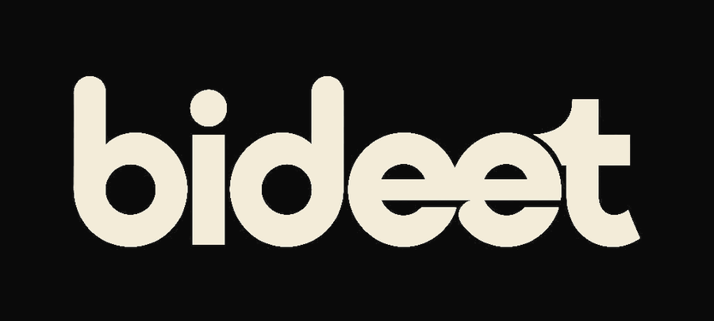

<div align="center">



### The last bid wins. Every time.

A live-auction marketplace in your pocket — built with Expo, React Native, and a real-time backend that never lets a sniper beat the clock.

[](https://expo.dev)
[](https://reactnative.dev)
[](https://www.typescriptlang.org)
[](./LICENSE)

</div>

---

## What is Bideet?

Bideet is a mobile marketplace where every listing is a **live auction**, not a fixed-price cart. Sellers put items up, buyers bid in real time, and the highest bid when the clock runs out wins — with a full order, delivery, and dispute-resolution flow carrying the sale through to a buyer's door.

It's built as a real product, not a demo: role-based accounts, live bidding over sockets, order lifecycle tracking, and an admin layer for resolving disputes — the same shape you'd expect from a production marketplace, scoped down to a foundation that's deliberately easy to expand.

## Why it's interesting

- ⏱️ **Real-time bidding** — bids land over a live socket connection, so the auction board updates the instant someone outbids you, not on the next pull-to-refresh.
- 🧑‍🤝‍🧑 **Four roles, one app** — Buyer, Seller, Auction Manager, and Admin all live in the same codebase, each unlocking a different slice of the UI as soon as a user's role allows it.
- 📦 **The auction is only step one** — winning a bid creates a real order: dispatch, delivery confirmation, auto-confirm windows, and a dispute flow with an admin-only resolution path, all wired end to end.
- 🪪 **Offline-aware by design** — auctions are cached on-device, so a spotty connection shows you the last good state instead of a blank screen.
- 🔐 **Fails safe, not silent** — storage and auth failures fall back gracefully instead of leaving you stuck on a cryptic error.

## How it's put together

```
bideet-app/
├─ app/              Expo Router routes — one file per screen (index, login, admin, managed, orders, …)
├─ src/
│  ├─ screens/        The actual screen components the routes render
│  ├─ components/      Shared building blocks (forms, bidding panel, keyboard-safe wrapper, …)
│  ├─ hooks/           Data-fetching + state hooks (auctions, orders, managed auctions, …)
│  ├─ api/             Typed HTTP client + endpoint wrappers
│  ├─ auth/            Auth context, token storage (with secure-store fallback)
│  └─ types/           Shared TypeScript types
└─ assets/             App icons, splash, and adaptive-icon layers
```

Navigation runs on **Expo Router** (file-based routing), state lives in small purpose-built hooks rather than a heavyweight global store, and the bidding surface talks to the backend over **Socket.IO** for live updates layered on top of a conventional REST API for everything else.

## Getting started

```bash
npm install
npx expo start
```

Scan the QR code with **Expo Go** on your phone, press `w` for a browser preview, or `a`/`i` for a connected emulator/simulator.

You'll need a running instance of the companion backend and a `.env` pointing at it:

```bash
# .env
EXPO_PUBLIC_API_URL=http://<your-backend-host>:3000
```

> Pointing at a physical device over Wi-Fi? Use your machine's LAN IP.
> Using an Android emulator? `10.0.2.2` reaches your machine's `localhost` directly.

### Building an installable app

Builds run in the cloud via **EAS** — no local Xcode/Android Studio required to ship a build.

```bash
npx eas-cli build --platform android --profile preview   # installable APK
npx eas-cli build --platform ios --profile preview        # TestFlight-bound build
```

## Roles at a glance

| Role | Can do |
|---|---|
| **Buyer** | Browse live auctions, place bids, track orders, confirm delivery, open a dispute |
| **Seller** | List items for auction, manage listings, track sales through to delivery |
| **Auction Manager** | Host and run assigned live auctions on a seller's behalf |
| **Admin** | Resolve open disputes — release funds to the seller or refund the buyer |

Every account starts as a buyer; the rest are opt-in upgrades from inside the app.

## Status

This is an active work-in-progress foundation — core auction, order, and dispute flows are built and tested end to end against a local backend. Payments, push notifications, and production hosting are the next frontier.

## License

[PolyForm Noncommercial License 1.0.0](./LICENSE) — free to use, study, and build on for any noncommercial purpose. Commercial use is not permitted without a separate agreement with the project owner.
